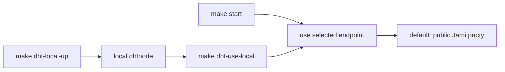

# How it works

Endpoint exchange is the core problem of peer-to-peer: each side must learn the other's public IP:port. stunmesh-go supports several storage backends for this (Cloudflare DNS, OpenDHT, external plugins); **this setup uses the built-in OpenDHT plugin against the public Jami DHT proxy** (`https://dhtproxy3.jami.net`) — endpoints travel over the public DHT network, so no DNS zone, account, or API token is needed.

- stunmesh-go discovers its own public IP:port via STUN and publishes it (Curve25519-encrypted) to the DHT
- The peer reads that value back and updates its WireGuard endpoint automatically
- Tunnel IPs: node A `10.66.0.1`, node B `10.66.0.2`

## Picking the DHT endpoint

`make start` uses the public proxy by default. It never starts Docker or changes
the selected endpoint automatically. If you want to use the bundled local
`dhtnode` instead (Docker Compose; REST proxy bound to loopback only), choose it
explicitly:

`make dht-use-local` persists `http://127.0.0.1:8080` in `state/settings.env`,
so the choice also applies to the macOS boot service. Use `make dht-use-public`
to restore the Jami endpoint. A custom endpoint written by hand in
`state/config.yaml` is still left untouched.

## Trusting the public proxy

`dhtproxy3.jami.net` is the Jami project's public OpenDHT REST proxy. It sees your source IP and the DHT keys you read and write, but never the endpoints themselves — every value is Curve25519-encrypted for the peer, so neither the proxy nor anyone else on the DHT can decrypt it. To keep even that metadata away from a third party, run your own `dhtnode` (the [`compose.yaml`](../compose.yaml) here works on any docker host) and hand-edit `endpoint:` to point at it — custom endpoints are never rewritten by `start`.

The optional OpenDHT container is pinned to the official `v4.1.1` multi-architecture image digest, so both machines run the same immutable image.

## Invariants worth knowing

- **OpenDHT values expire after 10 minutes**, so `dedup: false` must stay in the plugin config; the daemon republishes roughly every 60s.
- **macOS interface is a dynamic `utunX`** whose name changes per boot — its interface-name line in `config.yaml` is refreshed on every start. Linux uses a fixed `stunmesh0`.
- A **sleeping machine stops publishing** and drops the tunnel until it wakes and republishes.
- **Symmetric NAT on both sides cannot be punched through** (upstream limitation); one side needs a different network.
